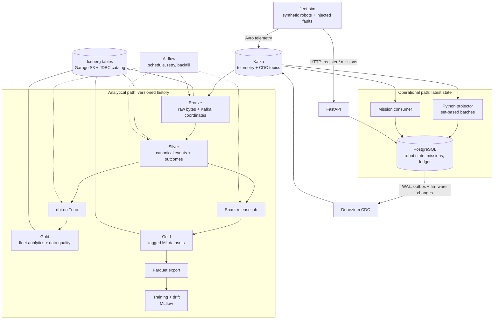

# FleetForge

**Fault-tolerant robot telemetry, reproducible analytics, and ML data pipelines.**

FleetForge is an end-to-end data platform for a **simulated warehouse robot fleet**. It consumes high-frequency telemetry that may arrive late, duplicated, out of order, or malformed; maintains correct latest-state information in PostgreSQL; and independently builds versioned analytics and machine-learning datasets from the same Kafka event log.

The engineering goal is not simply to move events through Kafka and Spark. It is to **preserve correctness across system boundaries, failures, replays, and historical corrections**—while measuring the cost of doing so.

| Operational throughput | Operational correctness | Analytical correctness |
|---|---|---|
| **4,997.5 events/s** over 303 s; **388 ms p99** event-to-state latency | **0 discrepancies** across 12,607 fault-injected deliveries versus an independent oracle | **46,696 Kafka records** in Gate A: incremental Silver = full rebuild = Python reference |

*Results are from local and CI test environments, not a production robot fleet. [Full methodology and measurements](docs/reviews/fleetforge-final-engineering-report.md).*

## Architecture



**Two paths, two responsibilities.** The operational path uses a batched Kafka consumer and PostgreSQL to answer *what is the robot's latest valid state?* The analytical path retains every ingested Kafka record in Bronze, reconstructs canonical history in Silver, and publishes Gold analytics and snapshot-pinned ML datasets. Debezium returns committed robot, mission, and firmware changes to Kafka so downstream consumers receive the reference and business events they need. Airflow orchestrates analytical jobs; it does not contain their transformation logic.

## One event, two outcomes

Suppose robot `R42` sends a valid observation for **boot 4, sequence 103**, followed by a delayed observation for **boot 4, sequence 102**.

| Stage | What FleetForge does |
|---|---|
| **Kafka** | Retains both messages with distinct offsets. |
| **Operational PostgreSQL** | Applies `103`; refuses to let the older `102` overwrite the latest state. |
| **Bronze / Iceberg** | Preserves the original bytes and source coordinates of **both** messages. |
| **Silver / Spark** | Retains valid historical observations and flags the late arrival as out of order, assuming no separate duplicate or sequence conflict. |
| **Gold / dbt** | Recomputes affected analytical results under the documented finality policy. Already published snapshot-pinned datasets remain unchanged. |

This is why **latest state** and **historical truth** are separate products: an observation can be too old to replace the live state and still be essential for analysis.

## Seven engineering decisions

These are the design choices that most directly address FleetForge's correctness, performance, and reproducibility goals—not a list of technologies used.

| Problem | Decision and precise mechanism | Why it matters |
|---|---|---|
| **Different read/write requirements** | **Separate operational and analytical consumers of Kafka.** PostgreSQL holds latest state; Iceberg holds raw and canonical history. | Analytical scans and historical corrections do not become part of the low-latency state-update path. The paths reconcile independently. |
| **Robot clocks and reboots** | **Order by server-assigned `(boot_number, sequence_number)`**, enforced by a conditional PostgreSQL `UPSERT` rather than `observed_at`. [ADR 0001](docs/adr/0001-ordering-key-server-assigned-boot-number.md) | An old-boot or late observation cannot overwrite newer state, even under concurrent writes. |
| **Kafka/PostgreSQL crash window and per-event commit overhead** | **Plan sequentially equivalent batches (up to 500 events); commit state, rejections, and the topic-UUID-bound offset ledger in one PostgreSQL transaction.** [ADRs 0006–0007](docs/adr/0006-kafka-ingestion-with-database-offset-ledger.md) | Redelivery is safe after crashes; set-based updates amortize durable commits without sacrificing per-event outcomes. |
| **Database-to-Kafka dual writes** | **Commit mission changes and outbox events together; Debezium publishes the WAL changes.** A separate connector streams firmware-reference updates. [ADR 0008](docs/adr/0008-outbox-cdc-with-debezium.md) | A committed mission change cannot be forgotten just because the broker was briefly unavailable. Consumers still deduplicate at-least-once events. |
| **Replay and schema evolution** | **Store byte-exact Bronze records keyed by `(topic UUID, partition, offset)`; put ingestion checkpoints in the same Iceberg commit and archive writer schemas.** [ADR 0013](docs/adr/0013-bronze-idempotent-ingestion.md) | Replays add no duplicate source records, and history can be decoded or reinterpreted later. |
| **Late events, corrections, and changed firmware contracts** | **Persist prepared Silver rows; recompute the affected event/correction/robot-boot dependency closure; require incremental output to equal a full rebuild.** [ADR 0017](docs/adr/0017-incremental-silver.md) | Smaller updates avoid unnecessary full rebuilds without changing the canonical historical result. |
| **Mutable data and irreproducible ML experiments** | **Pin Gold releases to Iceberg snapshot IDs, tag retained snapshots, hash canonical rows, and split by episode or robot.** [ADR 0018](docs/adr/0018-gold-dbt-and-spark-releases.md) | A released dataset can be reproduced after new telemetry, maintenance, or a disaster-recovery restore. |

### A failure that changed the design

During a real schema-registry restart, the decoder misclassified a **valid** event as permanently malformed. The root cause included transport errors raised by `httpx2` and transient `404` responses while registry state was recovering. The fix treats uncertain lookups as outages: hold and retry, then **durably park** unresolved records with their exact bytes and Kafka coordinates instead of silently discarding them. See [ADR 0016](docs/adr/0016-registry-uncertainty-is-never-malformed.md).

## Validation, not just green services

| Claim | Evidence from the released system |
|---|---|
| **Operational state remains correct** | Independent oracle matched the operational and analytical latest state after **12,607** fault-injected deliveries. |
| **Incremental Silver preserves full-rebuild semantics** | **37 differential tests**; real Kafka **Gate A (46,696 records)**, including a Spark kill between commits. Replay added zero logical rows. |
| **Orchestration recovers from tested faults** | **Gate B:** six injected failures, including Spark, Garage, scheduler, and real registry-lookup interruption; affected tasks retried and reconciliation passed **11/11**. |
| **ML inputs and results can be reproduced** | **Gate C:** exported dataset hashes and retrained metrics reproduced. The ML task uses an explicitly **synthetic label**, not real robot actions. |
| **Backups are usable** | Restore into a disposable stack matched **15/15 tables** and reproduced **2/2 dataset releases**. |

All three gates passed on the `v1.0.0` commit in the [full-system GitHub Actions run](https://github.com/efkontoes/fleetforge/actions/runs/43713666039). Details and exact test boundaries are in the [engineering report](docs/reviews/fleetforge-final-engineering-report.md) and [fault matrix](docs/reviews/fault-matrix.md).

## Run locally

**Requirements:** Linux or WSL2, Docker with Compose v2, and Python 3.12. The local stacks are resource-intensive; use one heavy profile at a time on a small machine.

```bash
make setup
source .venv/bin/activate
fleetforge env             # generate git-ignored local credentials
fleetforge up core         # Kafka + schema registry
fleetforge gate a          # Kafka -> Bronze -> Silver -> Gold -> dataset release
fleetforge gate c          # export -> train -> register -> drift checks
fleetforge down --all      # stop containers, preserve volumes
```

For the operational Kafka → PostgreSQL demonstration, run `fleetforge up m2` and `make publish` **separately** from the heavier lakehouse stack. Airflow workflows can be started with `fleetforge up airflow`; the larger fault-injection Gate B is intended for CI.

See the [lakehouse runbook](docs/operations/lakehouse-runbook.md) for reconciliation, recovery, backfills, and maintenance commands.

## Scope and limitations

FleetForge `v1.0.0` is a **tested local/CI platform**, not a production deployment. Its robot observations and ML target are simulated; AWS Terraform has been validated and planned but **never applied**. The lakehouse scale test used approximately **1.06 million records on one Spark core**, not a distributed production cluster. The intermittent Kafka producer stall after broker restart remains open as [issue #7](https://github.com/efkontoes/fleetforge/issues/7).

**Explore:** [Platform architecture](docs/architecture/platform.md) · [Exact table schemas](docs/architecture/milestone-3-tables.md) · [Benchmark report](benchmarks/milestone-2-report.md) · [Engineering report](docs/reviews/fleetforge-final-engineering-report.md) · [ADRs](docs/adr/) · [Release v1.0.0](https://github.com/efkontoes/fleetforge/tree/v1.0.0)
