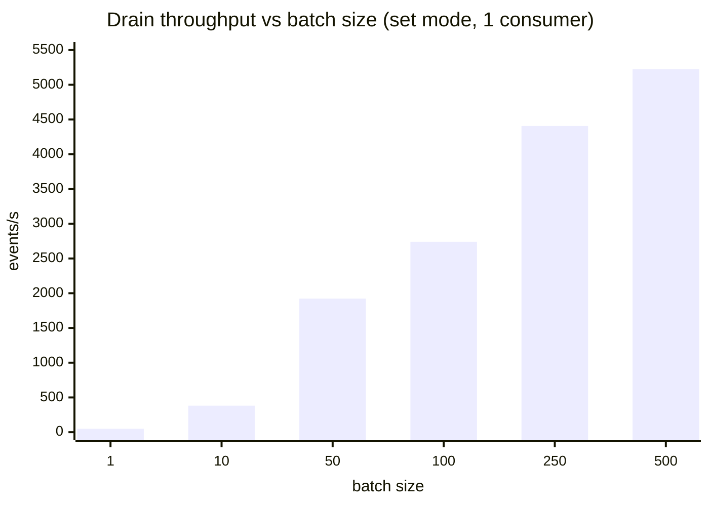

# Milestone 2 benchmark report

Every number in this report was measured on the machine below. Raw JSON for each
experiment is in `benchmarks/results/m2-*.json`. Estimates are labelled as such.

## Environment

| | |
|---|---|
| Host | Windows 11 laptop, Intel i5-10210U (4 cores / 8 threads, 1.6 GHz base), 7.8 GiB RAM |
| WSL2 | Ubuntu 24.04, 8 vCPUs, **3.7 GiB RAM** (default 50 % limit, deliberately not raised), 1 GiB swap |
| Storage | WSL2 ext4 virtual disk, Docker named volumes. `dd oflag=dsync`: ~2 ms per synced 8 KB write |
| PostgreSQL | 17.11, `synchronous_commit=on`, `fsync=on`, `wal_level=logical`, 768 MiB container limit |
| Kafka | 4.3.1 KRaft, 1 broker, RF=1, heap 384 MiB, 768 MiB limit; topics with 6 partitions |
| Registry | Apicurio 3.3.4 (KafkaSQL) |
| Clients | Python 3.12, confluent-kafka 2.16.1 (librdkafka 2.16.0), psycopg 3.3, SQLAlchemy 2.1 |
| During benchmarks | Only PostgreSQL, Kafka, registry and API running (Debezium, Grafana, Prometheus, exporters stopped) |

## Methodology

Measurement boundaries are never mixed:

| Name | Starts | Ends |
|---|---|---|
| HTTP latency | client sends request | HTTP response (DB committed) |
| Producer ack latency | `produce()` | broker acknowledgement (`acks=all`). Says nothing about PostgreSQL |
| Drain throughput | first projector batch starts | last batch committed |
| Event→state latency | Kafka CreateTime (set by the producer) | projector's `process()` returned (DB committed) |
| PostgreSQL commits / WAL | `pg_stat_database.xact_commit` and `pg_current_wal_lsn()` deltas; counters read after an 11 s settle (backend stats flush late) |

* Workload: the deterministic simulator with realistic faults (1 % duplicates,
  1 % reorders, 0.5 % invalid battery, 0.5 % malformed, 0.05 % reboots). Each run
  has **fresh robots and a dedicated topic and consumer group**.
* **Every run is checked against the in-memory oracle** (final state, versions).
  All runs in this report matched.
* The load generator is no longer the bottleneck. HTTP load comes from 4 OS
  processes × 8 threads (0.66 cores used). Kafka production uses 2 processes
  (~20,000 events/s available, ≥ 4× the drain rate).
* Registration happens through the API *before* each measured window.

Reproduce (core profile only):
```bash
make env && docker compose --profile core up -d --wait
API_PROCESSES=4 docker compose --profile core up -d api
python benchmarks/m2_benchmark.py http  --robots 200 --ticks 75 --processes 4 --threads 8
python benchmarks/m2_benchmark.py drain --robots 200 --ticks 75 \
  --modes per_event:1 loop:500 set:1 set:10 set:50 set:100 set:250 set:500 set_copy:500
for n in 1 2 3; do python benchmarks/m2_benchmark.py drain --robots 300 --ticks 75 --consumers $n --modes set:500; done
python benchmarks/m2_benchmark.py sustained --robots 500 --rates 2000 5000 7000 9000 --mode set:500 --consumers 3
```

## 1. Architectures A–D on the same workload (15,000 events, 1 consumer)

`m2-20261112T182603Z-http-api4.json`, `m2-20261112T184215Z-drain-sweep.json`

| Arch | What | Events/s | PG commits | Commits/event | WAL bytes/event | Server-side CPU |
|---|---|---:|---:|---:|---:|---|
| **A** | HTTP → PostgreSQL, 1 event/tx (4 API procs, 32 client threads) | **293** | 30,381 | 2.0 ¹ | 433 | API ~0.4 cores (docker sample) |
| **B** | Kafka → projector, 1 event/tx (`per_event`) | **50** | 15,129 | 1.0 | 653 | 0.36 cores |
| **C** | Kafka → projector, 1 tx/batch, 1 statement/event (`loop:500`) | **915** | 31 | 0.002 | 428 | 0.50 cores |
| **D** | Kafka → projector, set-based (`set:500`) | **5,224** | 31 | 0.002 | **80** | 0.93 cores |
| D′ | set-based, rows staged with COPY (`set_copy:500`) | 4,884 | 31 | 0.002 | 84 | 0.90 cores |

¹ `pool_pre_ping` issues an autocommit `SELECT 1` per pool checkout, which counts
as a commit. Isolated measurement: 2.01 commits per checkout with pre-ping, 1.03
without.

**Reading the table: Kafka vs batching.**
* **A → B (Kafka, no batching): 6× slower.** HTTP had 32 concurrent writers whose
  commits PostgreSQL could flush together (group commit). One consumer committing
  per event is a single serial writer: ~20 ms per event (decode, ledger
  lock/advance, lookups, upsert, ~4.6 ms commit). **Kafka is not automatically
  faster than HTTP.**
* **B → C (transaction batching): 18×.** One WAL flush per 500 events instead of
  per event, but still one network round trip per statement per event.
* **C → D (set-based SQL): 5.7×.** A constant number of statements per batch, and
  one row write per robot per batch.
* **WAL per event: 653 → 80 bytes (8×).** Superseded events never become row
  versions or index entries.
* **COPY vs `unnest()`:** COPY was 6.5 % slower at 500 rows. Building the COPY
  stream in Python costs as much as binding arrays, and adds a temp-table insert.
  Not adopted.

### Batch size sweep (mode `set`)

| Batch | 1 | 10 | 50 | 100 | 250 | 500 |
|---|---:|---:|---:|---:|---:|---:|
| Events/s | 49 | 382 | 1,922 | 2,740 | 4,407 | **5,224** |
| Transactions | 15,155 | 1,515 | 303 | 152 | 61 | 31 |
| COMMIT p50 (ms) | 4.79 | 5.15 | 4.04 | 4.06 | 3.99 | 4.21 |
| WAL bytes/event | 750 | 365 | 235 | 149 | 112 | 80 |
| Projector CPU (cores) | 0.35 | 0.46 | 0.60 | 0.67 | 0.86 | 0.93 |



**COMMIT latency is flat at ~4–5 ms regardless of batch size.** The flush cost is
per transaction, so throughput rises until the projector's own CPU is the limit:
0.93 cores at batch 500, effectively one saturated Python process.

## 2. Consumer concurrency (set:500, 22,500 events)

`m2-…-drain-scale-c{1,2,3}.json`. Consumers join the group *before* the backlog
arrives. The first attempt started them while the backlog was already there:
late joiners caused a stop-the-world rebalance inside the measured window, and
3 consumers measured slower than 2. That result was discarded as a measurement
artefact and the harness fixed.

| Consumers | Events/s | Projector CPU (cores) | Avg batch |
|---:|---:|---:|---:|
| 1 | 3,836 | 0.84 | 494 |
| 2 | 6,564 | 1.70 | 484 |
| 3 | **9,280** | 2.49 | 473 |

Near-linear scaling: robots are partitioned, so consumers never contend for rows.
(Single-consumer throughput is lower than in §1 because the producers' burst
overlaps the first ~20 % of this shorter drain.)

## 3. Sustained ingestion: does it keep up at 5,000 events/s?

500 robots, producer paced for 30 s, 3 projector processes running throughout
(`m2-20261112T185714Z-sustained-c3-final.json`, `m2-…-c3-5k-rep{1,2,3}.json`).

| Target | Achieved produce rate | Event→state p50 | p95 | p99 | Max | Producer ack p50 / p99 | Projector CPU | Kept up |
|---:|---:|---:|---:|---:|---:|---|---:|---|
| 2,000 | 1,938 | 93 ms | 151 ms | 185 ms | 0.26 s | 13 / 23 ms | 0.95 | yes |
| 5,000 | 4,753 | 144 ms | 942 ms | **2,105 ms** | 2.53 s | 13 / **1,820** ms | 1.41 | yes |
| 5,000 (rep 1) | 4,611 | 129 ms | 200 ms | 241 ms | 0.33 s | 12 / 22 ms | 1.37 | yes |
| 5,000 (rep 2) | 4,998 | 130 ms | 213 ms | 274 ms | 0.42 s | 12 / 22 ms | 1.39 | yes |
| 5,000 (rep 3) | 4,939 | 124 ms | 194 ms | 242 ms | 0.40 s | 12 / 22 ms | 1.35 | yes |
| 7,000 | 6,912 | 199 ms | 544 ms | 768 ms | 0.92 s | 12 / 100 ms | 1.87 | yes |
| 9,000 | 8,818 | 389 ms | 876 ms | 1,285 ms | 1.67 s | 12 / 97 ms | 2.39 | yes |

**Result.** The design target of **5,000 events/s is sustained end to end**:
produced to Kafka, validated, and committed to PostgreSQL, with every event
accounted for and the final state equal to the oracle. Typical p99 event→state
is ~250 ms. Measured up to ~8,800 events/s on this laptop, still keeping up.

**The outlier.** One of four 5,000/s runs had a 2.1 s p99. In that run the
*producer's* acknowledgement p99 was 1,820 ms (vs ~22 ms otherwise). The stall was
on the producer→broker side (host or Kafka I/O), not in the projector, and the
event→state latency includes it because it is measured from producer time.
On a shared laptop VM such tails are expected. Production would need a dedicated
broker disk and repeated runs to characterise tail latency properly.

**Where the time goes at 5,000/s.** Batches are much smaller than 500 when the
consumer keeps up (records arrive at ~1,700/s per consumer), so the
`flush_interval` (50 ms in the benchmark) and the commit (~4 ms) dominate
event→state latency, not CPU.

## 4. Recovery (from the failure tests, same machine)

| Scenario | Measured |
|---|---|
| PostgreSQL stopped 7.0 s while Kafka kept accepting | 7 retries, 0 records quarantined; backlog of 1,592 drained 3.2 s after restart; state = oracle |
| Kafka stopped 8 s during publishing | no acknowledgement for the whole outage; all messages acknowledged exactly once after restart; state = oracle |
| Projector crash after DB commit | resume from ledger: 0 records reprocessed. Trusting Kafka offsets instead: whole batch redelivered, 100 % `SKIPPED` |
| Debezium (Connect) restart | 43 s to `RUNNING` (6 s stop + 37 s JVM start); events committed meanwhile delivered in order, none lost |
| Backlog drain rate | = drain throughput above: ~3,800 events/s per consumer, ~9,300 events/s with 3 |

## 5. Milestone 1 → Milestone 2

| | Milestone 1 (measured) | Milestone 2 (measured) |
|---|---|---|
| Best ingestion into PostgreSQL | 354 events/s (4 API procs; client-bound) / 293 events/s (this report, client not bound) | 9,280 events/s drain (3 consumers), 8,818 events/s sustained |
| At the 5,000 events/s target | not reachable | sustained; p99 event→state ~0.25 s (one run in four: 2.1 s) |
| Commits per event | 1 (+1 pre-ping) | 0.002 |
| WAL per event | 433 B | 80 B (backlog drain, batch 500) |
| Database outage | 503 to producers (they must buffer) | Kafka buffers; automatic catch-up |

## 6. Bottleneck analysis

1. **Single-row durable commits** (M1, and B). A ~4.6 ms flush per event, removed by
   batching. Evidence: flat COMMIT latency across batch sizes; throughput
   proportional to events per commit until the CPU limit.
2. **Round trips per event** (C). Removed by set-based SQL. Evidence: C vs D at the
   same transaction count.
3. **Python CPU in the projector** (D). Avro decoding, validation and planning cost
   ~0.18–0.27 cores per 1,000 events/s. Evidence: 0.93 cores at 5,224 events/s
   with one process; linear scaling with processes. PostgreSQL ran at
   ~40–90 commits/s and low CPU during these tests: it is not the bottleneck.
4. **Shared 4-core host.** Producers, Kafka, three projectors and PostgreSQL all
   compete for the same cores. This is the limit for further local scaling.

## 7. Capacity projection (estimate, not measured)

Assuming per-process cost stays ~0.27 cores per 1,000 events/s and PostgreSQL is
on its own disk: 6 projector processes (one per partition) on 2 dedicated cores
each would sustain roughly **15,000–20,000 events/s** before needing more
partitions. PostgreSQL would then commit ~40–60 batches/s, far from its limit.
Untested assumptions: network latency to a managed database (RDS adds ~1 ms per
round trip, which matters only for the per-event modes), Kafka with RF=3 (higher
ack latency), and larger robots-per-batch fan-out.

## 8. Decisions taken from these numbers

* Default projector mode `set`, batch 500, flush interval 200 ms in deployment
  (latency vs efficiency); scale by replicas up to the partition count.
* Keep `unnest()`; do not adopt COPY at these batch sizes.
* Keep `pool_pre_ping`: it costs one round trip per *checkout* (once per batch in
  the projector) and is what makes recovery from a database restart transparent.
* Cost/resource trade-off: Kafka + registry + Connect add ~1.5 GiB of RAM to the
  stack. In return they buy buffering, replay, CDC and ~30× ingestion capacity.
  Below ~300 events/s with no need for replay or CDC, Milestone 1's HTTP path is
  simpler and cheaper.

## Superseded raw files (kept for transparency)

| File | Why it is not used |
|---|---|
| `m2-…184248Z-drain-consumers2-SUPERSEDED-…json`, `m2-…184306Z-drain-consumers3-SUPERSEDED-…json` | Consumers started while the backlog was already present; late joiners caused rebalances inside the measured window (3 consumers measured slower than 2). Replaced by `drain-scale-c{1,2,3}`. |
| `m2-…185054Z-sustained-c3-SUPERSEDED-…json` | 5,000 and 7,000/s runs whose "achieved rate" included forking and pickling the producer workload, understating it. (An earlier attempt crashed before saving: the projectors idled out while the producers were still being forked.) Replaced by `sustained-c3-final` and the three 5k repeats. |
