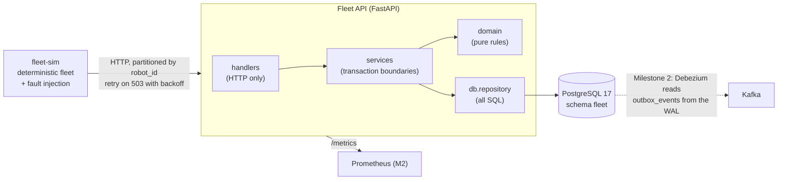
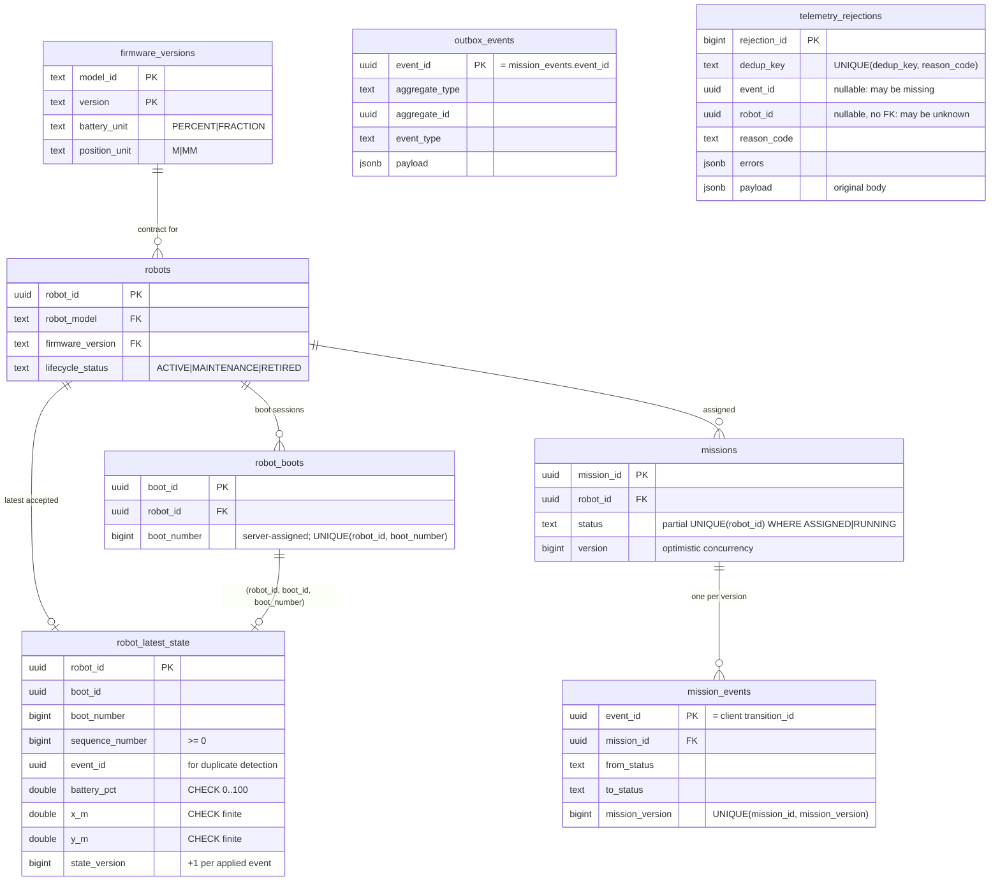

# FleetForge — Milestone 1 architecture

Milestone 1 is the operational foundation: a robot sends unreliable data and
PostgreSQL maintains the correct state. There is no Kafka, Debezium, Spark,
Airflow, Iceberg or LLM yet, by design.

## Data flow

| Layer | Module | Owns | Must not |
|---|---|---|---|
| Contracts | `fleetforge.contracts` | Wire formats (telemetry v1, API bodies) | contain rules beyond structure |
| Domain | `fleetforge.domain` | Validation, ordering decision, mission state machine | do I/O |
| Services | `fleetforge.services` | Transaction boundaries; orchestration | speak HTTP |
| Repository | `fleetforge.db.repository` | Every SQL statement | commit (the caller owns the transaction) |
| API | `fleetforge.api.app` | HTTP mapping, error → status, health, metrics | contain business rules |
| Simulator | `fleetforge.simulator` | Fleet model, faults, sender, oracle | import the DB or API |

## Database schema (ERD)

`outbox_events` and `telemetry_rejections` deliberately have no foreign keys:
an outbox row describes an aggregate of any type, and a rejection may concern a
robot that does not exist.

Migrations (`database/migrations/versions/`): `0001` registry, `0002` missions +
outbox, `0003` latest state + rejections. They are hand-written SQL so reviewers
see exactly the DDL the database receives.

### Constraints that carry correctness (requirement 4)

| Rule | Enforced by |
|---|---|
| Newer state is never overwritten by older | `WHERE (boot_number, sequence_number) > (...)` in the upsert |
| Battery is 0–100, positions are finite, NaN impossible | `CHECK` on `robot_latest_state` |
| A stored boot number really belongs to that boot and robot | composite FK → `robot_boots (robot_id, boot_id, boot_number)` |
| Boot numbers are unique and ordered per robot | `UNIQUE (robot_id, boot_number)` + robot row lock |
| A robot runs at most one mission | partial unique index `uq_missions_one_active_per_robot` |
| Exactly one audit event per mission version | `UNIQUE (mission_id, mission_version)` |
| A transition is applied at most once | PK on `mission_events.event_id` (= idempotency key) |
| A retried rejection is audited once | `UNIQUE (dedup_key, reason_code)` + `ON CONFLICT DO NOTHING` |
| Robots only run known firmware | FK `robots → firmware_versions` |

## Transaction boundaries

| Operation | One transaction contains |
|---|---|
| Telemetry, structurally or semantically invalid | rejection insert |
| Telemetry, valid | boot lookup → conditional upsert → (if not applied) classification read → rejection insert |
| Robot registration | robot insert + `RobotRegistered` outbox event |
| Boot registration | robot row lock (`FOR NO KEY UPDATE`) → existing-boot check → insert `MAX + 1` |
| Mission create | mission insert + `mission_events` + outbox |
| Mission transition | idempotency check → version-guarded `UPDATE` → `mission_events` + outbox |

All transactions run at READ COMMITTED. Robot registration locks with `FOR NO KEY
UPDATE` rather than `FOR UPDATE`: the latter would conflict with the `KEY SHARE`
locks that foreign-key checks take, and would stall telemetry for that robot.

## Telemetry ordering policy

* The ordering key is `(boot_number, sequence_number)`, compared lexicographically.
* `boot_number` is assigned by the server when the robot registers a boot
  (`POST /v1/robots/{id}/boots`). It never comes from robot clocks or robot storage.
* `observed_at` is stored but never used for ordering (clock skew, NTP jumps,
  clock resets on reboot).
* Telemetry for an unregistered boot is rejected with `UNKNOWN_BOOT`, and the
  producer must register first. A delayed event from a previous boot is `STALE`.

| Incoming vs held | Outcome | HTTP | Audited in `telemetry_rejections` |
|---|---|---|---|
| no state yet, or greater | `APPLIED` | 200 | — |
| equal key, same `event_id` | `DUPLICATE` | 200 | — (counted in metrics) |
| equal key, different `event_id` | `CONFLICT` / `SEQUENCE_CONFLICT` | 409 | yes |
| smaller | `STALE` / `STALE_SEQUENCE` | 200 | yes |

`STALE` returns 200 on purpose. The decision is final, and a 4xx/5xx would make a
well-behaved producer retry forever.

## API contracts

| Method & path | Success | Errors |
|---|---|---|
| `POST /v1/robots` | 201 created / 200 already registered | 409 `ROBOT_ID_CONFLICT`, 422 `UNKNOWN_FIRMWARE` |
| `POST /v1/robots/{id}/boots` | 201 / 200 (idempotent on `boot_id`) → `boot_number` | 404 `UNKNOWN_ROBOT`, 409 `BOOT_ID_CONFLICT` |
| `POST /v1/telemetry` | 200 `APPLIED` / `DUPLICATE` / `STALE` | 409 `SEQUENCE_CONFLICT`, 422 `REJECTED` + `reason_code` + `errors[]` |
| `GET /v1/robots/{id}/state` | 200 with latest state, active mission, `age_s`, `is_fresh` | 404 `NO_STATE` |
| `POST /v1/missions` | 201 / 200 (idempotent on `mission_id`), status `PENDING` | 409 `MISSION_ID_CONFLICT`, 422 `UNKNOWN_ROBOT` |
| `POST /v1/missions/{id}/transitions` | 200, `replayed: true` on retry | 404, 409 `VERSION_CONFLICT` / `ROBOT_BUSY` / `IDEMPOTENCY_KEY_REUSED`, 422 `INVALID_TRANSITION` |
| `GET /v1/missions/{id}` | 200 | 404 `UNKNOWN_MISSION` |
| `GET /healthz` · `GET /readyz` · `GET /metrics` | liveness · DB ping · Prometheus | `/readyz` 503 when the DB is down |

Any request that cannot reach the database gets **503 `DATABASE_UNAVAILABLE` with
`Retry-After: 1`**. Because every write is idempotent, retrying is always safe.

The interactive OpenAPI documentation is at `http://localhost:8000/docs` when the
stack is running.

Telemetry reason codes: `MALFORMED_JSON`, `MISSING_FIELD`, `INVALID_FIELD`,
`UNSUPPORTED_SCHEMA_VERSION`, `BATTERY_OUT_OF_RANGE`, `OBSERVED_AT_IN_FUTURE`,
`UNKNOWN_ROBOT`, `UNKNOWN_BOOT`, `STALE_SEQUENCE`, `SEQUENCE_CONFLICT`.

## Failure handling (what is implemented and tested)

| Failure | Detection | Action | Test |
|---|---|---|---|
| Duplicate delivery | same key + same `event_id` | 200 `DUPLICATE`, no new state version | `test_duplicate_delivery_creates_no_logical_update` |
| Out-of-order delivery | lower `(boot, seq)` | 200 `STALE`, state unchanged, audited | `test_out_of_order_delivery_leaves_state_unchanged` |
| Delayed event from an old boot | lower `boot_number` | `STALE` | `test_new_boot_supersedes_old_boot_despite_sequence_reset` |
| Producer bug: same sequence, different event | same key, different `event_id` | 409, audited | `test_same_sequence_different_event_is_a_conflict` |
| Invalid value / missing field / bad JSON | contract + domain checks | 422 with reason, original payload audited | `test_battery_150_…`, `test_missing_field_…`, `test_malformed_…` |
| Concurrent writers | row lock + conditional `WHERE` | newest wins | `test_conditional_upsert_under_forced_race` (4 interleavings) |
| Failure midway through a mission change | exception before commit | full rollback, then retry succeeds once | `test_failure_midway_through_assignment_commits_nothing` |
| Lost response, client retries | idempotency keys | replay instead of re-apply | `test_retry_after_lost_response_is_safe`, `test_retried_transition_…` |
| Database unreachable | connection error / pool timeout | 503 + `Retry-After`; `/readyz` 503 | `test_unreachable_database_returns_503_with_retry_after` |
| Database restart (connections killed) | `pool_pre_ping` | connections replaced transparently | `test_pool_recovers_after_all_connections_are_killed` |

## Observability

* Logs are JSON lines on stdout. Every non-applied telemetry event is logged
  with `outcome`, `reason_code` and `event_id`.
* Metrics (`/metrics`):
  * `fleetforge_telemetry_events_total{outcome,reason}`
  * `fleetforge_telemetry_ingest_seconds{outcome}`
  * `fleetforge_mission_transitions_total{to_status}`
  * `fleetforge_db_unavailable_total`
* With several API processes, each process has its own counters (multiprocess
  aggregation is deferred to M2, when Prometheus is added).
