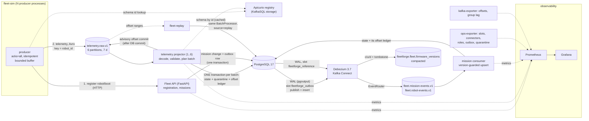

# FleetForge — Milestone 2 architecture: distributed ingestion, CDC, reliability

Milestone 1 wrote every telemetry event through HTTP into PostgreSQL in its own
transaction. Milestone 2 puts Kafka between the robots and the operational
database, moves state projection into a separate consumer that batches writes,
publishes business events with Debezium from the transactional outbox, and adds
quarantine, replay, observability and least-privilege roles.

Guarantee in one sentence: **at-least-once transport, effectively-once logical
state changes**, achieved by idempotent processing, ordering keys and database
constraints, not by Kafka's exactly-once features.

## Data flows

The legacy `POST /v1/telemetry` HTTP path still exists. It writes through the same
conditional upsert, which is safe alongside the projector (see "Two writers" below),
but it is a compatibility and benchmark path. `FLEETFORGE_HTTP_TELEMETRY_ENABLED=false`
turns it into `410 Gone`.

## Ownership

| Table / topic | Owner (only writer) | Role | Other access |
|---|---|---|---|
| `fleet.robots`, `fleet.robot_boots`, `fleet.firmware_versions` | Fleet API (registration) | `fleetforge_app` | projector reads (cached), CDC reads `firmware_versions` |
| `fleet.missions`, `fleet.mission_events`, `fleet.outbox_events` | Fleet API | `fleetforge_app` | CDC reads the outbox through the WAL |
| `fleet.robot_latest_state` | telemetry projector | `fleetforge_projector` | legacy HTTP path (same upsert), read API |
| `fleet.telemetry_rejections` (quarantine) | projector + replay | `fleetforge_projector` | API inserts rows for the legacy path |
| `fleet.consumer_offsets` | each consumer, its own `consumer_group` rows | projector / mission consumer | — |
| `fleet.replay_runs` | `fleet-replay` | `fleetforge_projector` | — |
| `downstream.mission_status` | mission consumer | `fleetforge_mission_consumer` | read-only role |
| `telemetry.raw.v1` | simulator / robots | — | projector, replay |
| `fleet.*-events.v1`, CDC topic | Debezium | `fleetforge_cdc` (replication) | any downstream consumer |
| `_schemas_apicurio` | Apicurio | — | — |

Privileges are enforced, not just documented: `tests/integration/test_roles.py`
checks 23 allowed and denied operations.

## Transactions, acknowledgements and durable state

| Step | Durable where | Acknowledged to whom | Transaction |
|---|---|---|---|
| Robot/boot registration | PostgreSQL | robot (HTTP 201/200) | API: robot row lock + insert |
| Telemetry publish | Kafka log (RF=1 locally) | producer, after `acks=all` | Kafka, per batch of records |
| Projection | PostgreSQL | nobody; the **ledger** row is the acknowledgement | projector: state + quarantine + ledger, one per batch |
| Kafka offset commit | `__consumer_offsets` | Kafka (advisory only) | separate; may lag or be lost |
| Mission change | PostgreSQL (mission + audit + outbox) | API client (HTTP) | API: one transaction |
| CDC publish | Kafka | Debezium flushes the slot LSN after Kafka acks | Connect offset + slot `confirmed_flush_lsn` |
| Mission projection | PostgreSQL | ledger row | mission consumer: state + ledger |

**Offset commits.** Kafka offsets and PostgreSQL commits cannot be atomic. The
projector therefore keeps its position *in PostgreSQL*
(`fleet.consumer_offsets`), updated in the same transaction as the state changes
derived from those records. On partition assignment it seeks to the ledger. The
Kafka commit afterwards only keeps the broker's lag view and `kafka-exporter`
accurate.

| Crash point | What happens on restart | Tested by |
|---|---|---|
| after poll, before DB commit | transaction never committed; records re-read | `test_crash_during_db_batch_leaves_no_trace` |
| inside the DB transaction | rolled back as a whole | same |
| after DB commit, before Kafka commit | default: resume from ledger, nothing re-read. If Kafka offsets are trusted instead, records are redelivered and every one is `SKIPPED` | `test_crash_after_db_commit_before_offset_commit[*]` |
| zombie consumer on the same partition | blocked on the ledger row lock, then skips | `test_two_consumers_racing_on_the_same_batch_apply_it_once` |

Two bugs these tests found: the first batch of a never-seen partition was
unfenced (`FOR UPDATE` locks nothing that doesn't exist; ledger rows are now seeded
first), and raw psycopg errors from set-based SQL bypassed the SQLAlchemy-typed
exception handling.

**The ledger is bound to one incarnation of the log** (final audit, ADR 0011).
Each row stores Kafka's topic UUID. On assignment the consumer checks
`low ≤ next_offset ≤ high`, and inside the batch transaction it checks that the
batch starts where the ledger says. A recreated topic, a ledger ahead of the log,
or records deleted by retention before being applied all stop the consumer with
`OffsetLedgerError` instead of being skipped silently. Before this check, all
three lost data without an error (reproduced against a real broker).

| Ledger/log disagreement | What happens | Tested by |
|---|---|---|
| topic deleted and recreated | refused (`topic id` mismatch); nothing applied, nothing skipped | `test_recreated_topic_is_refused_until_an_audited_reset` |
| ledger beyond the high watermark (legacy row, no UUID) | refused | `test_legacy_ledger_ahead_of_the_log_is_refused` |
| retention deleted unapplied records | refused at assignment and inside the transaction | `test_records_deleted_before_being_applied_are_refused`, `test_offset_gap_stops_the_consumer_without_committing[*]` |
| operator resets to 0 (reprocess) | honoured even though Kafka's committed offsets say otherwise | `test_reset_to_zero_reprocesses_even_if_kafka_offsets_say_otherwise` |

## Ordering

* Kafka key = `robot_id`, so all events of one robot are in one partition, in the
  producer's order. Kafka gives no order *across* partitions, and none is needed:
  robots are independent.
* Business order = `(boot_number, sequence_number)`, carried in the event and
  verified against `fleet.robot_boots` (`BOOT_NUMBER_MISMATCH` otherwise). Kafka
  partition, offset and timestamp are transport metadata: stored in the quarantine
  for traceability, never used to decide state.
* A batch may hold many events for one robot. `domain.ingest.plan_batch` replays
  them in delivery order against the state locked at batch start, so every event
  gets the decision it would have received alone. One row per robot is written:
  the winner, with `state_version += number of events applied`. The final state,
  versions and per-event outcomes equal the Milestone 1 oracle, which is asserted
  for every mode and for batch sizes 1, 7, 100, 250 and 500.

## Batch write path (mode `set`)

Per batch, independent of batch size:

1. `INSERT … ON CONFLICT DO NOTHING` seeds the ledger rows, then `SELECT … FOR UPDATE` locks them (fencing).
2. Registry lookups only for cache misses. Boot numbers and models are immutable, so a positive-only cache is safe.
3. `SELECT … FOR UPDATE` on the state rows of the batch's robots, ordered by `robot_id` (no deadlocks).
4. Plan in Python (pure function).
5. One multi-row conditional upsert via `unnest()` arrays, `RETURNING robot_id`. If the set differs from the plan, another writer intervened: roll back and retry.
6. One multi-row insert of audit rows.
7. One ledger upsert (`GREATEST`).
8. `COMMIT`: **one WAL flush per batch** instead of per event.

The conditional `WHERE (new) > (held)` stays in the upsert even though the plan was
made under locks. A robot without a row at lock time can still be inserted by the
legacy HTTP path, and the database must refuse to move backwards regardless.

## Error handling

| Category | Examples | Action | Offsets |
|---|---|---|---|
| Permanent data | malformed bytes, missing field, NaN, battery 150, unknown firmware, boot-number mismatch, sequence conflict, DB constraint violation | quarantine row (`QUARANTINED`) with topic/partition/offset, payload and bytes, category, reason, consumer version | advance |
| Permanent but `retry_eligible` | unknown robot or boot (registered later) | quarantine; `fleet-replay quarantine` re-runs them | advance |
| Recoverable infrastructure | DB down, timeout, **schema registry unavailable**: every registry failure except an explicit 404, of any exception class, and a 404 within the hold window (ADR 0016) | no quarantine; pause partitions, exponential backoff, retry the same batch (lag grows = backpressure) | hold |
| Unresolved (parked) | the registry kept answering 404 for a schema id beyond `projector_schema_unresolved_hold_s` (120 s); not proof of bad data | parked row (`PARKED`, category `UNRESOLVED`, retry-eligible) with coordinates and bytes; `TelemetryRecordsParked` pages; `fleet-replay quarantine --reason UNRESOLVED_SCHEMA_ID` once resolved | advance |
| Ordering | stale, duplicate, redelivered (`SKIPPED`) | stale recorded (`RECORDED`); duplicates/skips counted | advance |
| Unknown exception | bug | process exits; restart resumes from the ledger | hold |
| Position | ledger and Kafka log disagree (topic recreated, retention gap) | process stops (`OffsetLedgerError`), operator decides via audited `ledger-reset` | hold |

A batch refused by the database is re-run record by record so that one poison
record cannot block a partition (`DB_CONSTRAINT_VIOLATION`). There is deliberately
no dead-letter *topic*. The quarantine table is written in the same transaction
as the ledger; a DLQ topic would be a second, non-atomic write.

## CDC

* Debezium 3.7.1 with `pgoutput`. Two connectors, two slots, two pre-created
  publications. Autocreation is disabled, so the CDC role needs no ownership.
* `fleetforge_outbox` publishes **inserts only**. The EventRouter routes by
  `aggregate_type` to `fleet.<type>-events.v1`, keyed by `aggregate_id`, with
  `eventType` and `outboxCreatedAt` as headers and the JSON payload expanded.
  Outbox retention `DELETE`s never reach Kafka (tested).
* `fleetforge_reference` captures `firmware_versions` with `REPLICA IDENTITY FULL`:
  real insert/update/delete semantics with before and after images, plus
  tombstones, into a compacted topic. This is table CDC; the outbox is an event
  stream, and the two are deliberately separate.
* `snapshot.mode=initial`: on first start, existing outbox rows are published once
  (consumers deduplicate by version). Afterwards the connector resumes from its
  offset in `_connect_offsets`.
* WAL retention: a slot pins WAL until Debezium confirms it.
  `max_slot_wal_keep_size=2GB` caps the damage of an abandoned slot (the slot is
  invalidated rather than filling the disk). `ReplicationSlotRetainingWal` alerts
  at 512 MiB, `ReplicationSlotNearInvalidation` when `safe_wal_size` < 512 MiB,
  and `ReplicationSlotLost` once `wal_status = lost`.
* Delivery is checked end to end, not inferred from connector state:
  `fleetforge_cdc_missions_behind` / `fleetforge_cdc_oldest_undelivered_seconds`
  compare `fleet.missions.version` with `downstream.mission_status.version`, and
  `CdcDeliveryStalled` alerts on them. (`CdcEndToEndSlow` is computed from
  delivered events and stays silent during a total stall.)
* The mission consumer quarantines unparseable events in
  `downstream.mission_event_quarantine` with their Kafka coordinates, in the
  transaction that advances its ledger. Before the audit they were only logged.
* Heartbeats: quiet captured tables would otherwise pin all surrounding WAL
  (measured: 531 MB). Each connector inserts into `fleet.cdc_heartbeat` every 10 s,
  so its slot advances even when no business events happen (ADR 0008).
* Outbox retention (`python -m fleetforge.ops.retention`) deletes rows older than
  N days in chunks, and refuses while the outbox slot is inactive or lagging.

## Consistency actually provided

| Claim | Provided? |
|---|---|
| A committed robot state never moves backwards in `(boot, seq)` | yes: DB-enforced |
| Every event's logical effect is applied at most once | yes: ledger + ordering key + conditional upsert |
| Every published event is eventually processed or quarantined | yes, while Kafka retains it (7 days) and the projector runs. If retention or topic recreation removes records before they are applied, the projector **stops** (`OffsetLedgerError`, ADR 0011) instead of skipping them silently; an operator records the decision with `fleet-replay ledger-reset` |
| Read model is current | eventually. Measured event→state latency in the benchmark report; staleness is exposed and alerted |
| A committed mission change has its outbox event, and a rolled-back one has none | yes: the outbox row is written in the same transaction (rollback test) |
| That event reaches Kafka and the downstream consumer | **eventually**, while the replication slot is valid. Not atomic with the commit. Measured: Connect SIGKILLed during traffic, every transition delivered 27–46 s after restart (four runs). Stalls are detected end to end (`CdcDeliveryStalled`). If the slot is invalidated (`max_slot_wal_keep_size`), only a re-snapshot of rows still in the outbox recovers, so outbox retention refuses to run while the slot is unhealthy |
| Mission events delivered exactly once | **no**: at-least-once; consumers deduplicate by version |
| A robot's events arrive in order | per partition yes; across a producer failure **no**: events resent from the checkpoint after newer ones were delivered arrive late and are recorded STALE (state stays correct; verified by a conservation check in the stack tests) |
| Producer never loses events | **no.** Durability starts at the broker acknowledgement. A SIGKILLed producer loses its unacknowledged in-memory queue (tested). A producer that persists its last contiguous acknowledged index can resend from it, which gives duplicates (absorbed) and no loss. The simulator models this; a real robot must persist the checkpoint. An outage longer than `message.timeout.ms` (300 s) turns queued events into reported delivery failures (tested), never silent loss |
| Survives a broker loss | **no** locally (one broker, RF=1). Production needs RF=3, `min.insync.replicas=2` |
| Telemetry history in PostgreSQL | no, by design: Kafka retains the raw log until the M3 bronze layer persists it |

## Two writers to `robot_latest_state`

During the transition both the projector and the legacy HTTP endpoint can write.
That is safe: both use the conditional upsert, and the projector's plan is
re-validated against `RETURNING`. It is not *recommended*: interleaving two
transports per robot only makes sense in a migration window. Disable the HTTP path
when all producers use Kafka.
