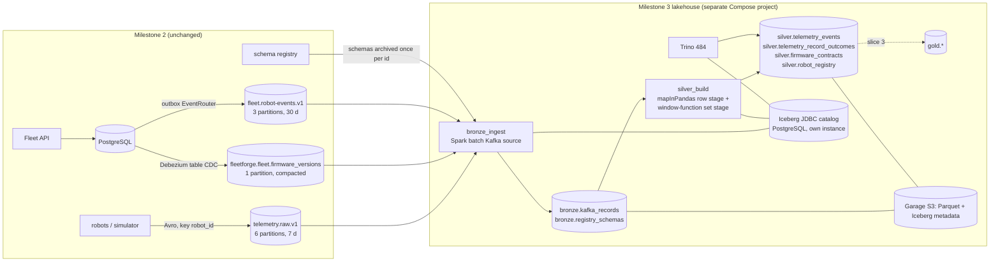

# FleetForge — Milestone 3 specification: lakehouse and data transformation

Status: **slice 1 (Kafka -> Bronze -> Silver -> Trino) implemented and proven on the
real engines**: 61 lakehouse unit tests, 14 Spark/Iceberg and S3 tests, 4 Trino tests
and 2 real-Kafka tests pass (see [§8](#8-test-execution-and-evidence)). Gold is
specified, not implemented. Branch `milestone-3-lakehouse`, rebased onto `main` after
PR #1 merged (`e819779`).

Companion documents: [exact table schemas](milestone-3-tables.md) (generated from
code), ADRs [0012](../adr/0012-lakehouse-storage-and-catalog.md),
[0015](../adr/0015-object-storage-garage.md),
[0013](../adr/0013-bronze-idempotent-ingestion.md),
[0014](../adr/0014-silver-deterministic-rebuild-and-outcome-lineage.md), and the
[learning guide](../learning/milestone-3.md).

## 1. Objective and scope

Turn unreliable raw robot telemetry into trustworthy, versioned, queryable
datasets:

    Kafka raw telemetry + CDC/outbox streams -> Bronze -> Silver -> Gold -> Trino

In scope: Spark for transformations, Iceberg tables (Parquet files) in
S3-compatible storage (Garage, ADR 0015), Trino for SQL, Python for validation logic.
Out of scope until later milestones: Airflow, dbt, the LLM assistant. Jobs are
plain CLI entry points; whatever schedules them later only needs their exit codes.

## 2. Architecture

Every table is an Iceberg table: Parquet data files and Iceberg metadata in
Garage, one pointer per table in the JDBC catalog. Spark writes, Trino reads,
through the same catalog.

## 3. Milestone 2 contracts, as implemented

Read from the code at `e683d32`, not from intentions.

| Contract | What the implementation provides | Source |
|---|---|---|
| Telemetry topic | `telemetry.raw.v1`, 6 partitions, RF 1, `retention.ms` 7 days, delete policy; declared, never auto-created | `infrastructure/kafka/create-topics.sh` |
| Other topics | `fleet.mission-events.v1`, `fleet.robot-events.v1` (3 partitions, 30 days); `fleetforge.fleet.firmware_versions` (1 partition, compacted) | same |
| Key / partitioning | key = UTF-8 `robot_id`, so all of a robot's events share one partition per topic incarnation | `simulator/kafka_publisher.py` |
| Value framing | Confluent wire format: magic byte 0, 4-byte big-endian schema id, Avro body. Decoded with the *writer* schema looked up by id | `kafka/codec.py` |
| Schema revisions | v1 and v2 (`heading_rad` optional, BACKWARD compatible); v3 is deliberately incompatible and only used to prove the registry rejects it. Producers never auto-register | `contracts/avro/*.avsc`, `kafka/schemas.py` |
| Event identity | `event_id` (UUID), identical across retries and redeliveries | Avro doc |
| Robot and boot | `robot_id`, `boot_id`, server-assigned `boot_number` (≥ 1), `sequence_number` (≥ 0, monotonic within a boot) | Avro, `domain/ingest.py` |
| Ordering | business order = `(boot_number, sequence_number)` per robot. Kafka guarantees order within a partition only. Robot clock (`observed_at`) is "stored, never used for ordering" | Avro doc, ADR 0001 |
| Times | `observed_at` (robot clock, timestamp-micros), `producer.produced_at` (producer clock), Kafka timestamp = CreateTime (producer clock, topic default) | Avro, topic config |
| Firmware | the event carries `firmware_version` only. Contracts `(model_id, version) -> battery_unit ∈ {PERCENT, FRACTION}, position_unit ∈ {M, MM}`; every seeded contract is PERCENT/M; M2 never converts units, it only checks that the contract exists | migration 0001, `processor.py` |
| CDC of firmware contracts | Debezium JSON (schemas disabled), envelope `before/after/source/op/ts_ms`, `REPLICA IDENTITY FULL`, tombstones after deletes | `infrastructure/debezium/reference-connector.json` |
| Outbox events | EventRouter, expanded JSON payload, key = aggregate id, headers `eventType`, `outboxCreatedAt`. `RobotRegistered` carries `robot_id, robot_model, firmware_version, lifecycle_status, registered_at` | `services/robots.py`, outbox connector |
| Corrections | a correction is a new event (`event_id` = uuid5 of original and attempt, `correction_of` = original) with the original's ordering key | `projector/replay.py` |
| Quarantine | `fleet.telemetry_rejections` in PostgreSQL with reason, category, `retry_eligible`, status, Kafka coordinates, payload and bytes | migration 0004 |
| Data-quality rules | structural (`observation_from_record`: required fields, schema_version = 1, finite numbers, seq ≥ 0, boot ≥ 1), semantic (battery in [0, 100], observed_at ≤ processing time + 300 s), referential (robot, boot, boot number, firmware contract) | `domain/ingest.py`, `domain/telemetry.py`, `processor.py` |
| Delivery | at-least-once from producers (duplicates across producer sessions); the projector is idempotent; no Kafka transactions on telemetry, so its offsets are contiguous | `kafka_publisher.py`, ADR 0011 |

### Contract gaps (documented before transforming)

| # | Gap | Consequence for the lakehouse | Handling now | Proposed fix (M2 side, not done here) |
|---|---|---|---|---|
| G1 | Telemetry has no robot model; contracts are keyed by `(model, version)` | Unit conversion needs `RobotRegistered` from the outbox topic, which keeps 30 days. Robots registered before Bronze started and more than 30 days ago are unknown | `UNKNOWN_ROBOT`, retry-eligible; a rebuild accepts them once the registry is known | Table CDC of `fleet.robots` into a compacted topic, or a one-off registry export into Bronze |
| G2 | Boot registration emits no event | `UNKNOWN_BOOT` and `BOOT_NUMBER_MISMATCH` cannot be reproduced; `boot_number` is copied, not verified | Documented on the column | Outbox event `BootRegistered` |
| G3 | `fleet-replay correct` applies corrections directly; they never reach Kafka | M2 corrections are invisible to Bronze; the lakehouse's history keeps the rejected original | Silver supports corrections that *do* arrive through Kafka (`correction_of`) | Publish corrections to `telemetry.raw.v1` |
| G4 | The M2 quarantine lives in PostgreSQL only, judged with the projector's wall clock | Silver recomputes its own outcomes deterministically; the two can differ at the 300 s skew boundary and for registry checks (G1, G2) | Silver uses Bronze `ingested_at` as the reference time | Reconciliation report M2 quarantine vs Silver outcomes (slice 4) |
| G5 | No coordinate frame, origin, axis convention or heading zero/rotation sense in the contract; heading only from revision 2 | Positions and headings cannot be fused across sites or models | Heading only wrapped into [-π, π); no frame assumed | Add frame id and convention to the contract |
| G6 | All seeded firmware contracts are PERCENT/M; the firmware topic is compacted with the default `min.compaction.lag.ms` (0) | Conversion paths are never exercised by real data; intermediate contract versions can be compacted away before ingestion | Synthetic FRACTION/MM contract in the fixture, clearly labelled | Set `min.compaction.lag.ms` on the CDC topic |
| G7 | Telemetry has no mission id; missions use server time, telemetry robot time | Mission-aligned training episodes are not reliable | `episode_id` = `boot_id` | Mission id in telemetry, or clock-sync metadata |
| G8 | Only a future-skew check on `observed_at`; no clock-sync data | Old or reset robot clocks are accepted and land in old partitions | Not rejected (no rule exists); visible in Gold quality | Lower-bound rule plus clock offset estimation |
| G9 | Schema ids depend on the registry's storage (Apicurio, KafkaSQL topic) | If the registry is rebuilt, ids can change meaning and old Bronze bytes become undecodable | Bronze archives every schema id it sees (`bronze.registry_schemas`) | — |
| G10 | Mission events are JSON without a registered schema | Contract lives only in consumer code | Ingested to Bronze as bytes; not modelled in slice 1 | Register a JSON or Avro schema |
| G11 | Kafka timestamps are CreateTime (producer clock) | `kafka_timestamp` is not a trustworthy arrival time | Stored as metadata only; arrival order uses Bronze ingestion | `message.timestamp.type=LogAppendTime` on the topic |
| G12 | Telemetry is low-rate scalar state: no images, scans, commands or actions | A learning dataset has no actions or rich observations | Gold product is labelled training-*candidate* | New streams, out of scope for M3 |

### Decisions on the highest-impact gaps

No Milestone 2 code was changed: none of these gaps blocks the vertical slice, and
each extension below is only justified once its trigger occurs. Nothing is
fabricated in the meantime.

| Gap | Decision now | Smallest backward-compatible extension | Needed when |
|---|---|---|---|
| G1 robot model | `RobotRegistered` from the outbox is the source. Bronze is the permanent archive of `fleet.robot-events.v1` (Kafka keeps 30 days), so a model is never lost once ingested. A missing model is `UNKNOWN_ROBOT`, retry-eligible, never guessed (scenario robot X, tested) | Add `fleet.robots` to the existing reference CDC connector (publication + `table.include.list`): a new compacted topic whose snapshot covers every existing robot; no existing consumer changes | The lakehouse is first deployed against a fleet with registrations older than 30 days |
| G2 boot registration | `boot_number` is copied and documented as unverified; it only orders events | New outbox event type `BootRegistered` on `fleet.robot-events.v1` in `register_boot` (same transaction) | Before a Gold training release can leave `CANDIDATE` |
| G3 operator corrections | **Reported as unsupported.** Corrections arriving through Kafka are supported and proven (two corrections, latest wins, superseding a rejected original). Corrections made by `fleet-replay correct` never reach Bronze, so the original stays `REJECTED` with `superseded_by` NULL | `fleet-replay correct` publishes the correction event to `telemetry.raw.v1` (key `robot_id`) instead of applying it directly; the projector then handles it on its normal, idempotent path | Corrections start to be used operationally |
| G5 coordinate frames | No frame assumed; heading only wrapped into [-π, π); training releases stay `CANDIDATE` | Avro revision with an optional `frame_id` (default NULL): BACKWARD compatible under the registry rule | Positions from more than one site or map are combined |
| G7, G12 episodes and actions | `episode_id = boot_id`, labelled provisional; no action or target columns are invented | Mission id on telemetry, and a command/action stream (new topics) | A learning task is defined (outside Milestone 3) |

## 4. Layer design

Exact columns, types, nullability, partitioning and sort order:
[milestone-3-tables.md](milestone-3-tables.md). Defined once in
`src/fleetforge/lakehouse/tables.py`; a unit test keeps the document identical.

### Bronze: immutable raw history

* `bronze.kafka_records`: one row per Kafka record of every source topic, bytes
  exactly as read (key, value, headers), plus topic, **topic id**, partition,
  offset, Kafka timestamp and type, value SHA-256, framing and schema id parsed
  from the bytes, ingestion run id and time. Identity
  `(kafka_topic_id, kafka_partition, kafka_offset)`.
* Partitioned by `source_topic, days(ingested_at)`: the CDC topics stay small,
  arrival-day partitions are append-only, and retention by age is a partition drop.
  Files are sorted by `(kafka_partition, kafka_offset)`, which gives tight offset
  min/max statistics.
* Duplicates, stale events, malformed and invalid records are all kept: Bronze
  records what was delivered, not what is true.
* `bronze.registry_schemas`: archive of every schema id seen (FOUND or an
  authoritative NOT_FOUND), so history stays decodable without the registry (G9).

Idempotency and restart (ADR 0013): checkpoint in the Iceberg commit,
insert-if-absent by identity, a fail-closed planner, and a single-writer lease.

### Silver: validated canonical telemetry

Silver = F(Bronze snapshot, reference data, schema archive, `TRANSFORM_VERSION`)
(ADR 0014). It is built incrementally from the checkpoint in `silver.build_log`, and
the update must equal a full rebuild over the same inputs (ADR 0017, see
"Incremental Silver" below). Two stages:

**Row stage** (`silver.prepare`, runs in `mapInPandas`), in order. The first
failure decides the reason:

| Step | Rule | Outcome | Rule source |
|---|---|---|---|
| framing | Confluent-framed Avro | `MALFORMED_PAYLOAD` | M2 codec |
| schema | id archived; `NOT_FOUND` → `UNRESOLVED` (retry-eligible, never malformed, ADR 0016); **not archived → job aborts** (recoverable, never a quarantine) | `UNRESOLVED_SCHEMA_ID` / abort | ADR 0016 |
| decode | writer-schema decode succeeds | `MALFORMED_PAYLOAD` | M2 codec |
| contract | required fields, `schema_version = 1`, finite numbers, seq ≥ 0, boot ≥ 1 | `MISSING_FIELD`, `UNSUPPORTED_SCHEMA_VERSION`, `INVALID_FIELD` | M2 `observation_from_record`, unchanged |
| reference | robot model known (G1); firmware contract for (model, version) | `UNKNOWN_ROBOT`, `UNKNOWN_FIRMWARE` (both retry-eligible) | M2 taxonomy |
| conversion | battery × {1, 100}; position ÷ {1, 1000} (exactly rounded) | — | firmware contract |
| semantic | battery in [0, 100] **after** conversion; observed_at ≤ Bronze `ingested_at` + 300 s | `BATTERY_OUT_OF_RANGE`, `OBSERVED_AT_IN_FUTURE` | M2 `check_semantics`, deterministic reference time |
| repair | non-finite optional values → NULL; heading wrapped into [-π, π) | flags `HEADING_NOT_FINITE`, `MOTOR_TEMP_NOT_FINITE`, `HEADING_WRAPPED` | Silver |

**Set stage** (`silver.build`; Spark mirror `jobs/silver_build.set_stage`).
"First" always means first in Bronze arrival order
`(ingested_at, kafka_topic_id, kafka_partition, kafka_offset)`:

1. Rejections from the row stage keep their reason. An unresolved schema id is the
   outcome `UNRESOLVED`, counted apart from `REJECTED`.
2. Per `event_id`: the first copy is the representative. A later copy with the same
   content fingerprint (business fields, excluding producer metadata and schema
   revision) is a `DUPLICATE`; with different content, `EVENT_ID_CONFLICT`.
3. Per ordering slot `(robot_id, boot_number, sequence_number)` among non-corrections:
   the first holds it; later ones are `SEQUENCE_CONFLICT` (M2 semantics).
4. Corrections: per target, the latest-arriving correction wins; the target (an
   accepted event or a rejected record) and losing corrections get `superseded_by`;
   `is_current = superseded_by IS NULL`.
5. `arrived_out_of_order`: an accepted event of the same robot with a greater
   ordering key arrived earlier.

Event-time ordering is the business key, never `observed_at` (robot clock).
Late events are *kept* (history is append-only by nature); lateness is a flag in
Silver and a recomputation trigger for Gold. Every Bronze telemetry record gets
exactly one row in `silver.telemetry_record_outcomes` (`ACCEPTED`, `DUPLICATE` or
`REJECTED` with reason, category, retry eligibility and JSON details). The
quarantine is the `REJECTED` subset, and its bytes are joined from Bronze by
coordinates. **Malformed records** (permanent, quarantined) are kept strictly
apart from **infrastructure errors** (registry unavailable, schema not archived,
lease taken, object store or catalog down), which abort the run before anything is
committed and are retried.

Schema evolution: decoding uses the writer schema (v1 and v2 both decode; a v1
record equals a v2 record with `heading_rad = NULL`). A new Silver column is an
Iceberg `ADD COLUMN` (metadata only) plus a rebuild that fills history from Bronze
bytes. A new business major version (`schema_version = 2`) is
`UNSUPPORTED_SCHEMA_VERSION` until Silver implements it, and then a rebuild applies
it to history.

### Incremental Silver (ADR 0017)

* `silver.telemetry_prepared` keeps every row-stage result, so a record is decoded
  once and again only when its inputs change.
* `silver.build_log` is the checkpoint, with one row per published build. ΔB is
  Bronze telemetry newer than the base build's largest `ingested_at`.
* Rows are prepared again when their robot's registration changed, when their model's
  firmware contract changed units, or when their schema id got a different archived
  answer.
* The set stage runs only on the closure of the changed rows: their robots, event ids
  and correction links, iterated to a fixed point. Robotless rows are included by
  event id or by coordinates.
* Writes go in this order: prepared MERGE, outcomes MERGE, one row-level MERGE that
  swaps the scoped robots' events, the reference tables, and last the build-log row.
  Each step is idempotent, so a crash anywhere is repaired by running again.
* A stale writer is detected by comparing the events table's snapshot with the one
  the build read. Iceberg validates the window after that. Either way the build is
  retried from the checkpoint.
* A full rebuild runs when there is no base build, the rule version changed, or
  `--full` is given.
* The build tags the Bronze and archive snapshots it read (`silver-base`), so snapshot
  expiry cannot remove the next build's inputs.

### Gold: data products (ADR 0018)

1. **Fleet telemetry and operational quality** (dbt on Trino, `dbt/models/gold`).
   Every model reads Silver at the snapshots of one build (`silver.build_log`, var
   `silver_build_id`, newest by default), never "whatever is current".
   * `gold.robot_daily_telemetry` (robot × observed day):
     * completeness is counted by distinct positions;
     * missing sequences are counted between consecutive observed positions of a
       boot, on the day of the later one, so a gap across midnight is not lost;
     * distance is summed only over consecutive sequence numbers with non-decreasing
       `observed_at`.
   * `is_final` is a policy, not a guess. A row is final when it is older than 14 days
     before the newest ingestion and its robot has no open retry-eligible record. An
     unreadable record counts for the robot of its Kafka key; one with no key blocks
     every robot. Final rows are frozen: later runs leave them alone unless they are
     reopened (`reopen`, or `reopen_from`/`reopen_to`).
   * `gold.pipeline_daily_quality` (ingest day × topic × outcome × reason).
   * `gold.pipeline_daily_rates` with explicit denominators:
     `bronze_records = classified + unresolved`, and rates are taken over classified
     records only (NULL when there are none).
2. **Training-candidate robot state observations** (Spark release job,
   `jobs/release.py`).
   * `gold.robot_state_observations` holds current Silver events of one pinned build:
     * `observation_id` is the current event id;
     * an episode is a boot (gap G7);
     * `dt` and velocities are finite differences only over consecutive steps with
       positive dt; otherwise they are NULL with `NO_PREVIOUS_STEP`, `SEQUENCE_GAP`
       or `NON_POSITIVE_DT`;
     * no actions are invented.
   * Two hash splits: `split` by episode and the stricter `split_robot` by robot.
   * `gold.training_dataset_releases` records the build, the snapshots of every input,
     the seed and a SHA-256 over the ordered rows. The release tags each input snapshot
     (`release-<id>`), so maintenance cannot expire them.
   * A release id is immutable. Rerunning with the same inputs returns it; other
     inputs are refused. A crash before the release row is written is cleaned up on
     retry. `reproduce` recomputes from the pinned snapshot and compares three hashes:
     the recorded one, the stored rows and the recomputation.

**Why passing SQL validation does not make it training-ready.** A release stays
`CANDIDATE` until, at minimum:

* *Synchronization*: a common clock or estimated per-robot clock offsets (G8),
  bounded inter-sample jitter, and alignment across modalities (none beyond scalar
  state today, G12).
* *Episodes*: boundaries that mean something for the task (missions, G7), with no
  episode split across train and test, and no near-duplicate episodes across splits.
* *Features and labels*: actions or commands and a defined prediction target
  (absent, G12); coordinate frames (G5); units normalized per firmware (done);
  documented normalization statistics computed on train only.
* *Quality gates*: per-episode completeness (missing sequences), out-of-order and
  correction rates under thresholds, no `UNKNOWN_*` rejections in the selected
  window, class or condition balance reported.
* *Reproducibility*: release pinned to a Silver build and an Iceberg snapshot,
  content hash recorded, retention of that snapshot guaranteed (tag), and a data
  card listing known limitations.

## 5. Reliability: failure handling and replay rules

Action vocabulary: **retry** (no commit happened; rerun is safe), **quarantine**
(permanent data problem, recorded with reason, processing continues),
**reject** (excluded with a reason in outcomes; not retryable without new data),
**escalate** (stop; an operator decides, and the decision is recorded).

| # | Failure | Detection | Action | Why it is safe |
|---|---|---|---|---|
| F1 | Spark job crash (any stage) | process exit | **retry** | Nothing is visible until the Iceberg commit; written-but-uncommitted files are orphans, removed by `remove_orphan_files` (older-than window) |
| F2 | Kafka replay / re-read of ingested offsets | anti-join on identity; checkpoint | none needed | Insert-if-absent: zero new rows (unit and stack tests) |
| F3 | Duplicate events (producer retries, new producer session) | Silver step 2 | `DUPLICATE` outcome; counted on the event | Content fingerprint excludes delivery metadata |
| F4 | Same event id, different content | Silver step 2 | **reject** `EVENT_ID_CONFLICT` | First copy kept; producer bug surfaced |
| F5 | Late / out-of-order arrival | Silver step 5; Gold changed-days set | kept, flagged; Gold days recomputed; days older than 7 days are final | History is append-only; flags are recomputed every build |
| F6 | Schema change: new compatible revision | decode with writer schema | none | Registry enforces BACKWARD; v1 = v2 with NULL heading |
| F6b | Schema id not archived / registry unavailable | Silver driver check; Bronze archiver | **retry** (abort before commit) | Never quarantined: the record may be fine |
| F6c | Unsupported business major version | row stage | **reject** `UNSUPPORTED_SCHEMA_VERSION`; rebuild after support is added | Bronze keeps the bytes |
| F7 | Iceberg commit conflict or failure | exception at commit | **retry** the run | Appends rebase automatically; overwrites validate; a failed commit leaves the table at the previous snapshot |
| F7b | Commit outcome unknown (timeout after the catalog update) | `CommitStateUnknownException` | **retry**; the run re-reads the checkpoint from the table | Checkpoint lives in the table, so the truth is re-read, never assumed |
| F8 | Partial backfill (some ranges, some days) | — | Bronze: ranges are independent, idempotent appends. Silver: full rebuild in slice 1, so partial Silver states cannot exist | Each Silver build is one atomic overwrite per table |
| F9 | Corrections to history: telemetry corrections | Silver step 4 | supersede, keep both versions, `is_current` | Original remains for audit |
| F9b | Corrections to reference data (firmware contract update) | reference fingerprint changes the build id | rebuild applies the new contract everywhere | Deterministic; previous build readable by snapshot |
| F9c | Correction of a Silver rule | `TRANSFORM_VERSION` bump | rebuild | Old build readable by snapshot until expired |
| F10 | Concurrent writers | single-writer lease (catalog advisory lock); post-commit parent check | second writer exits (**retry later**); a parent mismatch **escalates** | Lease covers process death; parent check covers lease loss |
| F11 | Object store interruption | S3 errors from Iceberg FileIO | **retry** (run fails before commit) | Uncommitted files are orphans; metadata pointer unchanged |
| F11b | Catalog database interruption | JDBC errors | **retry** | Commit is a conditional UPDATE; either applied or not |
| F12 | Retention gap: checkpoint < Kafka low watermark | planner | **escalate**; `--accept-gaps` records `[from, to)` in the snapshot summary | Mirrors ADR 0011 |
| F12b | Topic recreated (new topic id) | planner; topic id re-checked after the read | **escalate**; `--accept-new-incarnation` | Identity includes topic id; old rows stay distinct |
| F12c | Checkpoint beyond log end (truncation, unclean election) | planner | **escalate**, no override | Records already served were lost by Kafka |
| F12d | Read did not return the planned offsets | `verify_batch` | **retry**, then escalate | Nothing committed |
| F13 | Reference data missing (robot or firmware) | row stage | **quarantine**, retry-eligible; next rebuild re-evaluates | Rebuild is total, so recovery needs no replay tool |
| F14 | Malformed reference record (CDC/outbox) | `build_reference` | recorded as anomaly in the Silver commit summary, part of the build id | Never silently skipped |

### Exactly-once: what is and is not claimed

* **Bronze**: each Kafka record identity appears **at most once**, guaranteed by
  insert-if-absent plus a single writer. It appears **at least once** for every
  offset that Kafka still retains and that the planner covered, because the
  checkpoint only advances in the same atomic Iceberg commit as the data. Together
  that is effectively-once *per record identity*, within these boundaries: one
  writer at a time (lease), Kafka retention (beyond it, an escalated gap), and one
  topic incarnation (beyond it, an escalated new incarnation). Spark's Kafka source
  is *not* transactional with Iceberg. There is no distributed transaction. Safety
  comes from idempotence, not from atomicity across the two systems.
* **Silver**: a build is a pure function of a pinned Bronze snapshot. Each table
  is replaced in one atomic commit. **Across tables there is no transaction**:
  for a moment, outcomes can be from build N+1 while events are from build N.
  Consumers pair tables by `silver_build_id`; events are written last and act as
  the publication marker.
* **Logical events**: Silver keeps one row per `event_id`. Two different events
  for the same slot are a `SEQUENCE_CONFLICT`, never two "current" rows.
* Not claimed: exactly-once from robot to Kafka (M2: at-least-once), or
  completeness beyond Kafka retention.

## 6. Technology inventory (pinned, compatibility checked 2026-11-13)

| Component | Pin | Why this version | Evidence |
|---|---|---|---|
| Apache Spark | 4.1.4 (Scala 2.13), PySpark 4.1.4 | Newest Spark line with an Iceberg runtime; 4.2.1 and 4.3.0 exist, but Iceberg publishes no runtime for them | Maven Central: `iceberg-spark-runtime-4.2_2.13` returns 404; `-4.1_2.13:1.12.0` exists |
| Apache Iceberg | 1.12.0 (`iceberg-spark-runtime-4.1_2.13`, `iceberg-aws-bundle`) | Latest release (2026-09-25); table format v2 | Maven Central |
| Spark Kafka source | `spark-sql-kafka-0-10_2.13:4.1.4` | Must equal the Spark version | Maven Central |
| PostgreSQL JDBC | 42.7.14 | Iceberg JDBC catalog driver | Maven Central |
| Java (Spark) | Temurin 21 JRE `21.0.12.1_1` (digest-pinned) | Spark 4.1 supports 17 and 21 | Docker Hub |
| Python libs | pandas 2.3.3, pyarrow 25.0.1, trino 0.340.0 | PySpark 4.1.4 declares pandas ≥ 2.2, pyarrow ≥ 15. Resolved together with the project lock on Python 3.12, `pip check` clean, `pip-audit` clean (`requirements-lakehouse.lock`) | PyPI metadata; runtime verified by the stack tests |
| Trino | 484 (digest-pinned) | Latest; JDBC catalog; reads Iceberg v1 and v2 (v3 "experimental", so tables pin v2); bundles Java 25 | Trino 484 docs |
| Catalog DB | PostgreSQL 17 (same digest as M2 tests), separate container | Iceberg JDBC catalog: no extra catalog service on a 3.7 GiB machine | ADR 0012 |
| Object storage | Garage v2.5.0 (`dxflrs/garage`, digest-pinned), single node | Maintained; 5/5 S3 operations; 43 MiB peak vs SeaweedFS 500 MiB; prebuilt image | ADR 0015 (measured) |
| AWS SDK v2 setting | `AWS_REQUEST_CHECKSUM_CALCULATION=WHEN_REQUIRED`, `AWS_RESPONSE_CHECKSUM_VALIDATION=WHEN_REQUIRED` on Spark and Trino | Garage rejects the SDK's default trailing upload checksums | Bug B1 below |
| Spark driver | heap 768 MB; metaspace 320 MB, direct 256 MB, code cache 96 MB caps; `MALLOC_ARENA_MAX=2`; `local[1]`; container 2 GiB | Measured budget: peak 1.77 GiB | Bug B5 below |

Alternatives considered (details in ADRs): Delta Lake or Hudi instead of Iceberg
(Iceberg is engine-neutral and Trino's Iceberg support is first-class); a REST
catalog (Polaris, Lakekeeper, Nessie) instead of JDBC (more realistic for
production, but one more service); SeaweedFS, AIStor Free or the archived MinIO
instead of Garage (ADR 0015); Spark Structured Streaming
instead of bounded batches (offsets live in a checkpoint directory outside the
table; batch ranges are explicit and testable); DuckDB or PyIceberg for local
tests (no JVM, but not the engines this milestone teaches).

## 7. Implementation plan and acceptance criteria

| Slice | Content | Acceptance criteria | Status |
|---|---|---|---|
| 0 | Isolation, contract inventory, gaps, schemas, versions, failure rules | This document; worktree at `e683d32`; nothing in M2 changed | done |
| 1a | Pure core: Bronze mapping and planner, reference data, Silver row and set stages, scenario | Every scenario record gets its stated outcome; order independence; bit-identical rebuild; replay inserts nothing; fail-closed planner cases; schema not archived → abort, not quarantine | **done: 61 unit tests pass** |
| 1b | Spark jobs and lakehouse stack | Spark Bronze columns = Python reference; insert-if-absent on Iceberg; Spark Silver = Python reference (differential); unchanged inputs → no new snapshot; late batch → new build, previous readable by snapshot; checkpoint survives compaction | **done: 9 Spark tests pass (incl. scenario check and two crash-restart tests)** |
| 1c | Trino query | Trino results = reference; time travel; quarantine joins to source bytes; types as documented | **done: 4 Trino tests pass** |
| 1d | Real Kafka source | ingest, replay, topic recreation refused; Avro with real registry ids to Silver | **done: 2 Kafka tests pass** |
| 2 | Incremental Silver | Process only new Bronze snapshots (Iceberg incremental read), MERGE by identity with per-robot state; **equals the full rebuild** on randomized scenarios; compaction and snapshot expiry jobs | planned |
| 3 | Gold products | Both products built from a pinned Silver build; changed-days recomputation; release table with content hash; training-readiness checks reported, release stays CANDIDATE | planned |
| 4 | Operations | Scheduling entry points, metrics (lag Bronze vs Kafka, rejection rates), reconciliation M2 quarantine vs Silver outcomes, retention policy (Bronze kept beyond Kafka's 7 days), runbook | planned |

## 8. Test execution and evidence

Executed 2026-11-13 on the 3.7 GiB WSL machine with the Milestone 2 stack stopped,
one phase at a time, and repeated on a fresh GitHub Actions runner by the CI workflow. JUnit XML: `docs/reviews/evidence/milestone-3/`. CI runs the
same phases (`.github/workflows/lakehouse.yml`).

| Phase | Command | Running services | Result | Peak memory (measured) |
|---|---|---|---|---|
| unit | `.venv/bin/pytest tests/unit tests/integration tests/failure tests/lakehouse` | Testcontainers PostgreSQL | **247 passed, 20 skipped** (87 M2 unit + 61 lakehouse unit + 93 integration + 6 failure; the 20 skips are the stack tests below) | — |
| 0 | `make -f lakehouse.mk lake-build` | — | Spark image 885 MB; Ivy resolved the 4 packages (15 jars); the JRE runs in the Python base | — |
| 1 | `make -f lakehouse.mk lake-test` | Garage, catalog DB, Spark (`local[1]`) | **14 passed** (5 S3 conformance + 9 Spark/Iceberg), 212 s | container 1.77 GiB of 2 GiB; per process: JVM 1,282 MiB, Python workers 363 MiB, pytest 321 MiB; no OOM kill |
| 2 | `make -f lakehouse.mk lake-test-trino` | Garage, catalog DB, Trino | **4 passed**, 10 s | Trino 1.0 GiB |
| 3 | M2: `docker compose --profile core up -d --wait kafka schema-registry`; `make -f lakehouse.mk lake-test-kafka` | + M2 Kafka and registry only | **2 passed**, 118 s; test topics and subjects deleted afterwards | Kafka 564 MiB, registry 301 MiB, Spark 1.49 GiB |

Milestone 2's 25 live-stack tests (`tests/stack`) need its full stack and were not
run locally; on PR #2, Milestone 2's own CI ran them on this branch: 19 non-disruptive
and 6 disruptive passed, with 148 unit and 99 integration/failure tests (run
43524858480). The `lakehouse` workflow reproduced 61 unit, 14 Spark/S3, 4 Trino and
2 Kafka passes on a fresh runner (run 43523627495).

### Guarantees and the tests that prove them

| Guarantee | Evidence |
|---|---|
| Bronze preserves raw records and coordinates | `test_spark_bronze_columns_equal_the_python_reference` (every column of every record, Spark vs reference); `test_quarantine_joins_back_to_the_exact_source_bytes` (Trino) |
| Replay does not duplicate Bronze records | `test_bronze_append_is_insert_if_absent_and_carries_the_checkpoint`; `test_ingest_replay_and_recreation_against_real_kafka` |
| Deterministic validation and deduplication | `test_spark_silver_equals_the_python_reference` (row for row); `test_rebuild_with_unchanged_inputs_is_a_no_op` (same build id, no new snapshot) |
| Every result matches the scenario | `test_spark_outcomes_match_every_scenario_expectation`; `test_kafka_avro_with_real_registry_ids_to_silver` (same, from real Kafka bytes with real registry ids) |
| Late arrivals per policy | `test_late_batch_creates_a_new_version_and_the_old_one_stays_readable`; out-of-order flags in the scenario check |
| Invalid records identifiable and traceable | one outcome row per Bronze record with reason and JSON errors; Trino join back to the exact bytes |
| Corrections | Kafka-borne: supersession, latest wins (scenario). Operator corrections: unsupported, reported (G3) |
| Reproducible queries by snapshot | `VERSION AS OF` in Spark and `FOR VERSION AS OF` in Trino return the previous build |
| Trino reads the same committed versions | `test_current_version_matches_the_reference`, `test_previous_version_is_readable_by_snapshot` (build id from the snapshot summary) |
| Safe restart after a failed job | `test_bronze_crash_before_commit_restarts_without_loss_or_duplicates`; `test_silver_crash_between_tables_is_detectable_and_heals_on_restart`; checkpoint walk past compaction |
| Schemas archived from the real registry | 2 FOUND + 1 authoritative NOT_FOUND, idempotent (Kafka test) |
| Iceberg commits an empty append | yes (`empty_append_created_snapshot=True`) |

### Bugs found by the first executions

| # | Symptom | Root cause | Fix |
|---|---|---|---|
| B1 | Every Iceberg metadata write: `InvalidRequestException: Invalid payload signature (400)` | AWS SDK v2 (Iceberg's aws bundle, also Trino) sends uploads aws-chunked with a trailing checksum by default; Garage v2.5.0 rejects that signature form. The pyarrow probe passed because the C++ SDK does not do this | `AWS_REQUEST_CHECKSUM_CALCULATION` / `AWS_RESPONSE_CHECKSUM_VALIDATION = WHEN_REQUIRED` on Spark and Trino; reproduced both ways first; pinned by a unit test |
| B2 | Bronze append: `PLAN_VALIDATION_FAILED_RULE_IN_BATCH` (CollapseProject) | Spark 4.1.4 optimizer: `dropDuplicates` plus Iceberg's write projection yields an unresolved plan (the same plan counts fine); isolated with four plan variants | `row_number()` window over the identity (same "first copy wins") |
| B3 | `lake-guard` would refuse the lakehouse's own second command | It matched every container name starting `fleetforge-`, including `fleetforge-lakehouse-*` | Exclude the lakehouse project |
| B4 | Real Kafka: `illegal topic id '0/lHs2ReR2i9LwLnxKhAcg'` | librdkafka prints topic ids in standard base64 (`+`, `/`); the check assumed the URL-safe alphabet of Java clients | Accept both alphabets; quotes and backslashes still refused; unit test with the real id |
| B5 | `Py4JNetworkError` mid-run; kernel: `Memory cgroup out of memory: Killed process (java)` at 1.35 GB RSS | Off-heap regions (metaspace, direct buffers, code cache, GC threads) are not bounded by the heap; with a 1 GB heap the JVM plus Python workers exceeded the container limit late in a long session | Off-heap caps, heap 768 MB, `MALLOC_ARENA_MAX=2` (glibc arenas fragment native memory outside every JVM limit), one Spark task thread (`local[1]`: Python workers 586 → 363 MiB), container 2 GiB. A 1 GB heap was killed again late in a long session, and so was the 768 MB heap once without the arena cap and with two threads: the margin was luck, not design, until the budget was measured |
| B6 | CI only: `PermissionError: [Errno 13] Permission denied: '.env'` in the Kafka phase | Milestone 2's settings read `./.env`, which holds its secrets with mode 600; the Spark container (uid 10001) ran with the checkout as its working directory. Locally the Milestone 3 worktree had no `.env` | The container's working directory is its home; tests run by absolute path. The secrets file stays unreadable to the lakehouse, as it should. Reproduced and verified locally first |
| B7 | Found by reading a Milestone 2 CI failure (below), not by a lakehouse test failing | The schema archive treated NOT_FOUND as final, using the same "404 while the registry holds the subject" rule as Milestone 2, and the archive was not part of the Silver build id. A registry restart answering 404 for an existing id would have quarantined valid records as malformed permanently, and a corrected archive would not have triggered a rebuild | Only FOUND is final: NOT_FOUND ids are asked again every run, and a FOUND row wins. The archive's fingerprint is part of the build id. Unit test plus all 20 stack tests rerun |

Concerns that did **not** materialise: pandas/Arrow conversion in `mapInPandas`,
struct comparison in the out-of-order window, Iceberg JDBC catalog initialisation,
path-style S3 addressing, and Trino reading Spark-written metadata all worked on the
first execution.

### Milestone 2 finding (reported, not changed here)

On PR #2, Milestone 2's CI failed intermittently on the docs-only commit `2b49af4`,
while the identical code had passed one commit earlier:
* first attempt: `test_schema_evolution_on_the_real_registry` hung for its 5-minute
  timeout (`Connect to [::1]:29092 failed: Connection refused`);
* re-run: `test_registry_outage_pauses_projection_and_never_quarantines` failed. A
  valid event (expected `BATTERY_OUT_OF_RANGE`) was quarantined as `MALFORMED_PAYLOAD`
  during the registry outage. That is the case `kafka/codec.py` describes as
  "suspected but NOT observed": a restarting registry answering 404 for an id it
  holds, after it has already reloaded the subject. It has now been observed.

This is a Milestone 2 data-correctness defect (a valid event can be quarantined
permanently). It needs its own fix and review on `main`; it is not changed on this
branch. The lakehouse no longer depends on that rule being right (B7).

## Integration with Milestone 2

* Rebased onto `main` after PR #1 merged (`e819779`); the pre-rebase head is kept as
  tag `m3-pre-rebase-83b2dac`. Milestone 2's final commits changed no contract
  surface, so the gaps above still hold.
* Milestone 3 changes no Milestone 2 file except additive lines in `pyproject.toml`
  (an extra, markers, one lint rule) and `.gitignore`. Its Makefile targets live in
  `lakehouse.mk`; its CI in `.github/workflows/lakehouse.yml`.
* It reuses Milestone 2 code read-only: `observation_from_record`,
  `check_semantics`, `identity_hints`, `payload_for_audit`, `json_safe`, `REASONS`,
  `schema_str`, `register`, and two private helpers (`kafka.codec._registry_down`,
  `kafka.offsets.topic_id`).
* The Kafka test phase uses only Milestone 2's `kafka` and `schema-registry`
  services, with dedicated topics and subjects it deletes afterwards.
