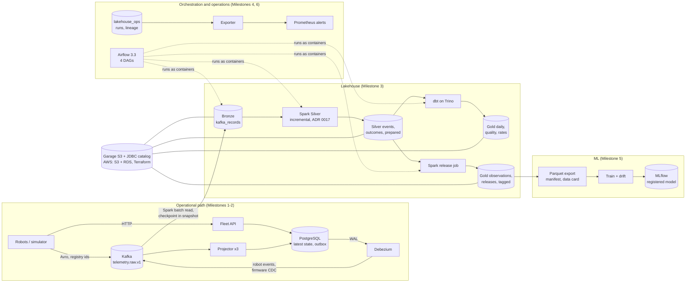

# FleetForge platform architecture

| Layer | Engine | Storage | Guarantee | Proof |
|---|---|---|---|---|
| Kafka → PostgreSQL | Python projector, set-based batches | PostgreSQL 17 | effectively-once state, offset ledger in the same transaction | M2 audit; 5k/s × 300 s and 10k/s × 60 s, oracle-checked |
| Kafka → Bronze | Spark 4.1 batch | Iceberg 1.12 on Garage | insert-if-absent by (topic id, partition, offset); checkpoint in the commit | Gate A replay adds 0 rows; Kafka counts equal Bronze per partition |
| Bronze → Silver | Spark (row stage in Python, set stage in SQL) | Iceberg | incremental equals full rebuild; one outcome per record | 37 differential tests; Gate A at 46,696 records; final E2E oracle |
| Silver → Gold | dbt on Trino; Spark releases | Iceberg | pinned to one Silver build; final days frozen; releases immutable and tagged | dbt equals the Python reference; releases reproduce after expiry |
| Gold → ML | export job, scikit-learn, MLflow | Parquet, MLflow file store | byte-identical export; reproducible training | Gate C |
| Orchestration | Airflow 3.3, each job a container | Airflow's PostgreSQL; runs in `lakehouse_ops` | exit 75 is retried, exit 65 stops; one writer at a time | Gate B: six faults on a CI runner, reconciliation after each |

Separate Compose projects keep the stacks apart on a 3.7 GiB machine: Milestone 2
(`compose.yaml`), the lakehouse (`infrastructure/lakehouse`), Airflow
(`infrastructure/airflow`, joined to Milestone 2's network). On AWS the same images would
run as ECS tasks against S3 and RDS (`infrastructure/terraform`, ADR 0021). That
configuration is planned and scanned in CI but has never been applied.
